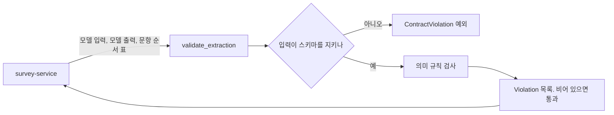

# turn-engine

## 1. 소개

문진 AI가 내놓은 "환자 답변 해석"이 말이 되는지 규칙으로 다시 검사하는 작은 파이썬 라이브러리다(현재 0.4.0).

모델(LoRA-A)은 환자의 말을 읽고 "어떤 칸에 무슨 값을 저장하고, 다음에 어떤 문항을 물을지"를 JSON으로 낸다. 모델은 가끔 틀린다. 이 라이브러리는 그 JSON이 계약의 의미 규칙(저장 대상, 다음 문항, 건너뛰기 순서, 저장 여부)을 지키는지 확인해 위반 목록을 돌려준다. 의료 기록에 틀린 값이 들어가는 것보다 다시 묻는 편이 안전하다는 이유로 둔 안전망이다(`docs/boundary.md` 8절, INTERFACES I8).
하지 않는 것: 모델 호출, 저장소 접근, 네트워크, 파일 읽기·쓰기, 서버 실행. 서비스가 아니라 라이브러리라서 포트, `/healthz`, 컨테이너 이미지가 없다(`docs/boundary.md` 1절). 형식(스키마) 검증은 model-runtime의 몫이다. 0.4.0에서 예전 v1 함수(`normalize`, `judge`, `write_record`, `plan`)를 제거했다.

## 2. 전체 속의 위치

| 방향 | 상대 영역 | 인터페이스 | 내용 |
|---|---|---|---|
| 받음 | boundary-contracts | v2.0.2 태그의 `ActionExtractionInput`, `ActionExtraction` 스키마 | 입력 형식 검증에 사용. 복사본 없음 |
| 받음 | survey-service(호출자) | I8 호출 | 모델 입력, 모델 출력, 문항 순서 표를 인자로 넘김 |
| 줌 | survey-service | I8 `validate_extraction` 등 | 위반 목록. 위반이 있으면 `OUTPUT_INVALID`와 같게 처리(D75-1) |
| 줌 | model-lab, synthetic-data, model-runtime(시험) | `ENGINE_VERSION`, `DATASET_V2_FLOW`, `validate_extraction` | 같은 버전이면 같은 결과 |

출처: `docs/boundary.md` 2, 3, 6절. HTTP 경로는 없다(라이브러리).

## 3. 구조

| 경로 | 역할 |
|---|---|
| `turn_engine/__init__.py` | 공개 API 7개와 `ENGINE_VERSION` |
| `turn_engine/validation.py` | `validate_extraction`: 스키마 검사 뒤 의미 검사 |
| `turn_engine/flow.py` | `QuestionFlowTable`, `SkipRule`, `DATASET_V2_FLOW`(31문항, 건너뛰기 7건, 임시) |
| `turn_engine/_common.py` | `ContractViolation` |
| `tests/test_validation.py` | 검증 규칙, 결정성, 의존 태그, 버전, 공개 API 시험 |
| `scripts/validate_dataset_a.py` | 학습 데이터 A를 표준입력으로 받아 전수 검사 |
| `pyproject.toml`, `requirements.lock` | 버전과 의존(boundary-contracts v2.0.2 고정) |
| `docs/` | 아래 7절 |



위반 코드: `OUTPUT_SCHEMA`, `TARGET_NOT_IN_VALUES`, `NEXT_ITEM_MISMATCH`, `SKIP_ORDER_MISMATCH`, `SAVE_RULE`, `UNKNOWN_ITEM`(`docs/boundary.md` 8-1).

## 4. 실행 방법

전제: Python 3.10 이상, boundary-contracts를 받을 수 있는 GitHub SSH 키. Docker, GPU, 네트워크 서버는 필요 없다(`docs/runbook.md`).

```
cd turn-engine
python3 -m venv .venv
. .venv/bin/activate
pip install -e ".[dev]"                       # 설치
python -m pytest tests -q                     # 시험
python -c "import turn_engine; print(turn_engine.ENGINE_VERSION)"
```

잠금 파일로 설치하려면 `pip install -r requirements.lock` 뒤 `pip install -e . --no-deps`. 이 영역은 서버가 없어 스모크 테스트와 이미지 빌드는 해당하지 않는다. 비밀 값(NAME_FILE, D84)도 쓰지 않는다. 학습 데이터 전수 검증은 학습 서버를 읽기 전용으로 읽는 명령이라(`docs/runbook.md`) 이 README에는 적지 않았고 이번에도 돌리지 않았다.

이 문서를 쓰는 세션에서 직접 돌린 것: `git status`, `pytest --collect-only`(40개 수집), `pytest tests -q`(39 통과, 1 건너뜀, 경고 2), `ENGINE_VERSION` 출력(0.4.0). `pip install`은 이미 있는 `.venv`를 썼고 새로 설치하지 않았다. 새 환경에서의 설치는 확인하지 않았다.

## 5. 현재 상태

확인된 것:
- 버전 0.4.0, 태그 `v0.4.0`은 커밋 23973fc를 가리키고 원격(origin)에도 올라가 있다(`git ls-remote --tags origin`으로 확인). `main`은 그 위에 README 커밋 하나가 더 있다.
- `.venv`에서 39 통과, 1 건너뜀(실행). 건너뛴 시험은 학습 데이터 A 전수 검사이며 환경 변수 `TURN_ENGINE_DATASET_A`가 없어서다(`pytest -rs`로 확인).
- 0.3.0 시점에 학습 데이터 A 5,077행 전수 위반 0(`docs/CHANGELOG.md` 0.3.0 항목). 0.4.0에서 다시 돌린 기록은 찾지 못했다(`docs/STATUS.md`는 0.3.x와 출력이 같다고만 함).

확인하지 못한 것:
- 깨끗한 두 번째 환경에서의 설치와 시험(`docs/STATUS.md` 남은 일 4).
- 이웃 영역이 실제로 제거된 이름을 안 쓰는지: 문서의 grep 결과를 옮긴 것이며 이 세션에서 다시 확인하지 않았다(`docs/boundary.md` 8-2).

## 6. 이 영역의 열린 항목

헤드 대장 `head/docs/OPEN_GAPS.md`에서 이 영역에 해당하는 것(읽기 전용으로 읽음).

| ID | 요약 | 상태 | 막고 있는 것 |
|---|---|---|---|
| G07 | v1 함수 제거 | 닫힘(23973fc, v0.4.0) | 해당 없음 |
| U11 | `validate_extraction` 기반 의미 위반율 지표를 평가에 넣지 않음 | 열림 | 다른 영역·사용자 결정(boundary 규칙과 충돌, 허락 필요, 학습 담당 확인) |
| U12 | 두 번째 독립 머신에서의 영역 시험 확인 | 열림 | 다른 환경 필요(GPU 아님) |

대장에는 없지만 이 리포 문서에 열려 있는 것: CR-010(`QuestionFlowTable`을 문진 스키마에서 만드는 방법과 출처. `DATASET_V2_FLOW`는 임시), `docs/rules/`와 CR-001~009를 지울지(둘 다 헤드 결정 대기, `docs/STATUS.md`). CR-010은 대장 ID가 없고, 현재 API 사용과 0.4.0 릴리스를 막지 않는다.

## 7. 더 자세한 문서

| 문서 | 내용 |
|---|---|
| `CLAUDE.md` | 이 영역 에이전트 지침 |
| `docs/brief.md` | 영역 목적, 범위, 수용 기준(1~3절을 0.4.0 구조로 고침) |
| `docs/boundary.md` | 제공 API, 위반 코드, 검사 규칙, 버전 부여, 장애 영향 |
| `docs/design.md` | 내부 구조 |
| `docs/runbook.md` | 개발 환경, 시험, 학습 데이터 검증, 릴리스 절차 |
| `docs/STATUS.md` | 마지막 세션 상태 |
| `docs/CHANGELOG.md` | 버전별 변경 이력 |
| `docs/change-requests/` | 헤드에게 보낸 변경 요청(CR-001~009 역사 기록, CR-010 열림) |
| `docs/rules/` | v1 시점 업무 규칙 기록(구현 없음) |
| `docs/adr/` | 구조 선택의 '왜'(D89): 라이브러리, 검증 경계, 순수 설계, I8 범위, v1 제거, 계약 태그 의존, 전수 시험 옵션 |

### ADR 목록

- [0001 라이브러리로 둔다](docs/adr/0001-라이브러리로-둔다.md)
- [0002 구조 검증만 하고 값 타당성은 서비스가 한다](docs/adr/0002-구조-검증만-하고-값-타당성은-서비스가-한다.md)
- [0003 순수 함수와 최소 의존](docs/adr/0003-순수-함수와-최소-의존.md)
- [0004 I8의 범위](docs/adr/0004-I8의-범위.md)
- [0005 v1 함수를 제거한다](docs/adr/0005-v1-함수를-제거한다.md)
- [0006 계약 패키지를 태그로 의존한다](docs/adr/0006-계약-패키지를-태그로-의존한다.md)
- [0007 학습 데이터 전수 시험을 옵션으로 둔다](docs/adr/0007-학습-데이터-전수-시험을-옵션으로-둔다.md)
